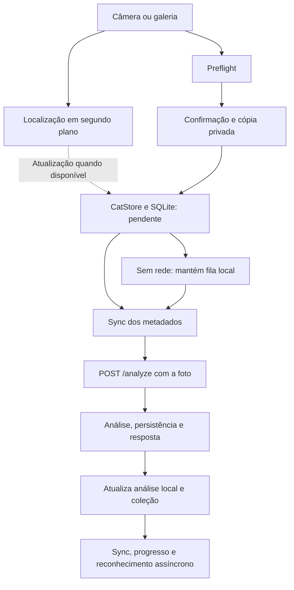

# Fluxos e mecanismos de desempenho — 21/10/2026

Objetivo: os mesmos resultados e comportamento no celular, com menos trabalho
interno. Nenhuma página, widget, texto, animação, imagem, resolução ou regra de
negócio foi alterada nesta rodada.

## Mapa do cliente



| Fluxo | Implementação principal | Invariantes |
|---|---|---|
| Abrir aplicativo/trocar conta | SessionStore, CatStore.loadCats, CatalogSyncCoordinator | Cache filtrado por conta, registros locais convidados, configurações e descarte de resposta da conta anterior. |
| Capturar foto | CapturePage, preflight, CatStore.addFromTempPhoto | Mesma câmera/galeria, limites 1920/qualidade 85 existentes, orientação, localização assíncrona, confirmação e status. |
| Analisar/repetir pendentes | CatStore.syncPendingAnalyses, AnalysisApiService | Metadados primeiro, mesmos bytes, estados e erros; fila/retry e chave de autenticação. |
| Sincronizar catálogo e referências | CatalogSyncService, CatDatabase e repositórios | Dirty/tombstone, conflitos, cursor, fotos por tipo, reinício e operação offline. |
| Detalhes/coleção | CatDetailsController, CatCollection, análises e referências | Mesmo agrupamento, ordem e conteúdo, ações, mídia e apresentação. |
| Favoritos, comunidade e resgate | FavoritesManager, SocialApiService, páginas de resgate/pistas | Mesmos dados visíveis, autorização, filtros e navegação. |
| Conversas | ConversationController, SocialApiService e WebSocketService | Carregamento paralelo de detalhes/mensagens, otimistas, anexos, recibos, polling quando desconectado e reconexão. |
| Quintal | HabitatService/Repository → produção/layout → cache → HabitatGame | Rascunho, fila idempotente, saldo/estoque, relógio, animações, seleção, câmera e efeitos. |
| Notificações | AccountActivityController e NotificationStore | Push/WS atualizam a mesma caixa, refresh concorrente já combinado, leitura e paginação preservadas. |

## Implementado e medido

`CatalogSyncCoordinator.read` carregava gatos, todas as análises do banco e uma
lista de referências por gato. Agora utiliza dois métodos em lote dos repositórios,
filtrados pelos mesmos IDs que a consulta de gatos já autorizou. As referências
continuam em `kind ASC`; gatos sem foto continuam presentes com lista vazia.

| Cenário | Antes | Depois |
|---|---:|---:|
| Snapshot com N gatos visíveis, até 500 | N + 2 consultas | 3 consultas |
| 41 registros visíveis (40 da conta + convidado) | 43 | 3 |
| 502 registros visíveis | 504 | 5 |
| Catálogo vazio | 2 | 1 |
| Análises de D registros dirty, até 500 | D | 1 |

Acima de 500 IDs, o trabalho é dividido em lotes limitados, deduplicados, abaixo do
limite portátil de 999 parâmetros SQLite. Não há consulta para seleção vazia.
Não se carrega análise de outra conta para descartá-la depois.

O teste usa o schema real e SQLite FFI, compara os mapas de gatos/análises/fotos
com os métodos anteriores e mede chamadas reais de consulta. Inclui convidados,
outra conta, exclusões, IDs repetidos/ausentes e 501 gatos da conta. Métodos
públicos anteriores continuam disponíveis; não houve alteração ou migração do schema 17.

A API também passou a carregar páginas de sync em lote e a liberar a conexão de
autenticação antes da IA no envio principal. O mapa completo, riscos e próximas
medições estão em [performance_flows.md da API](https://github.com/EveDoescher/gatalogo-api/blob/code-quality-cleanup/docs/performance/performance_flows.md).

## Próxima fila de avaliação

1. Medir abertura de clientes HTTP durante um sync; avaliar reutilização por
   operação com fechamento garantido, preservando headers, retry e timeouts.
2. Medir reenvio de foto primária após análise: suprimir somente com confirmação
   de hash/conta, sem perder upload após alteração/reinício.
3. Medir downloads de referências inalteradas: reutilizar só com validação de conteúdo.
4. Avaliar sobreposição entre snapshot de habitat e resposta de produção, mantendo
   efeitos de visita, rascunho, conflitos e fallback.
5. Perfilar build/raster/CPU no aparelho antes de cachear camadas estáticas da cena;
   qualquer cache precisa invalidar com câmera, layout, seleção e iluminação.
6. Medir consultas da lista de conversas/feed na API antes de reorganizar leituras
   sem alterar autorização, paginação e recibos.

Não foram alterados timers, debounce de ações, frequência de animação, JPEG,
modelos, políticas de retry ou ordem de escrita para obter ganho aparente.

## Validação

Focados de snapshot/persistência/auto-sync: **9 aprovados**.
Regressão completa: **278 aprovados, 6 condicionais e zero falhas**.
`flutter analyze --no-pub`: **nenhum apontamento** na análise final.
Integração API: **324 aprovados**; complemento final: **10 aprovados**, ambos
sem falhas/ignorados e com banco/API descartáveis. O cliente live executou as
fases antes/depois do reinício com perda de resposta após commit e troca de conta.

Logs locais ignorados: `performance-focused-tests.log`, `performance-full-tests.log`
e `performance-final-analysis.log`. Os seis condicionais permanecem os da base;
o cliente live foi coberto pelo harness da API. Fonte/CI não dependem dos logs.
Os números são de consultas; não representam medição de latência/FPS no celular.
Sem testes em dispositivo físico, build Android ou emulador nesta rodada.

Reprodução local das medições:

```powershell
flutter test --no-pub test/catalog_read_performance_test.dart
```
