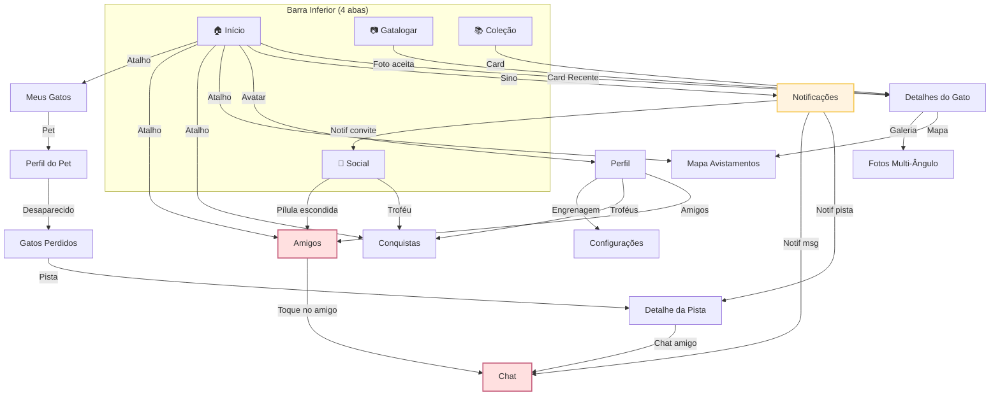
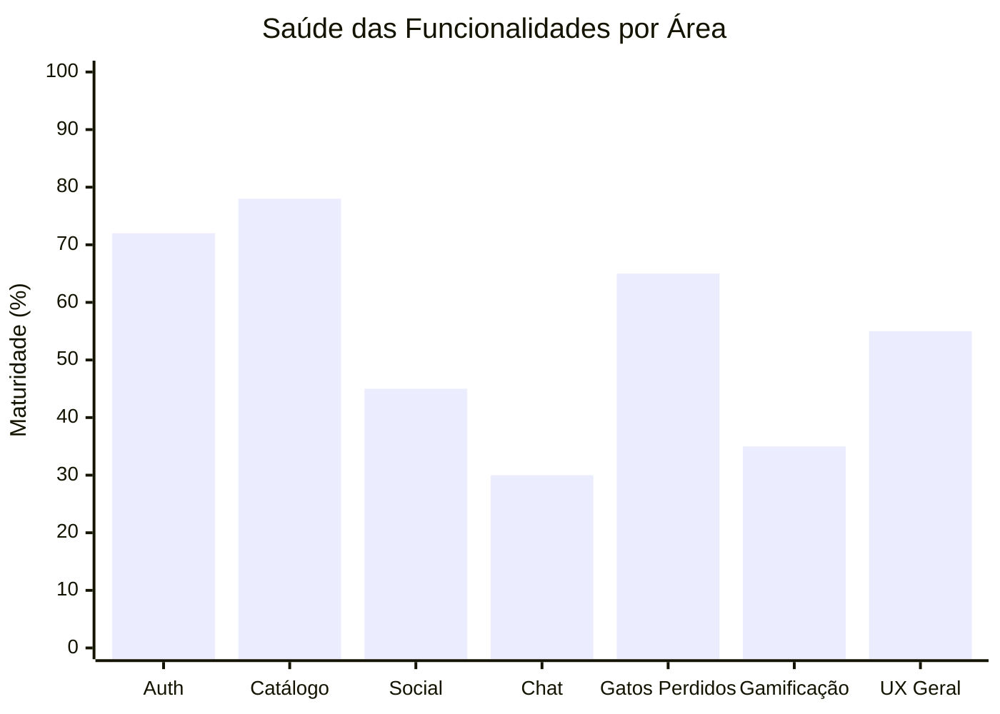
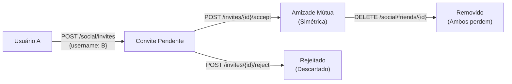
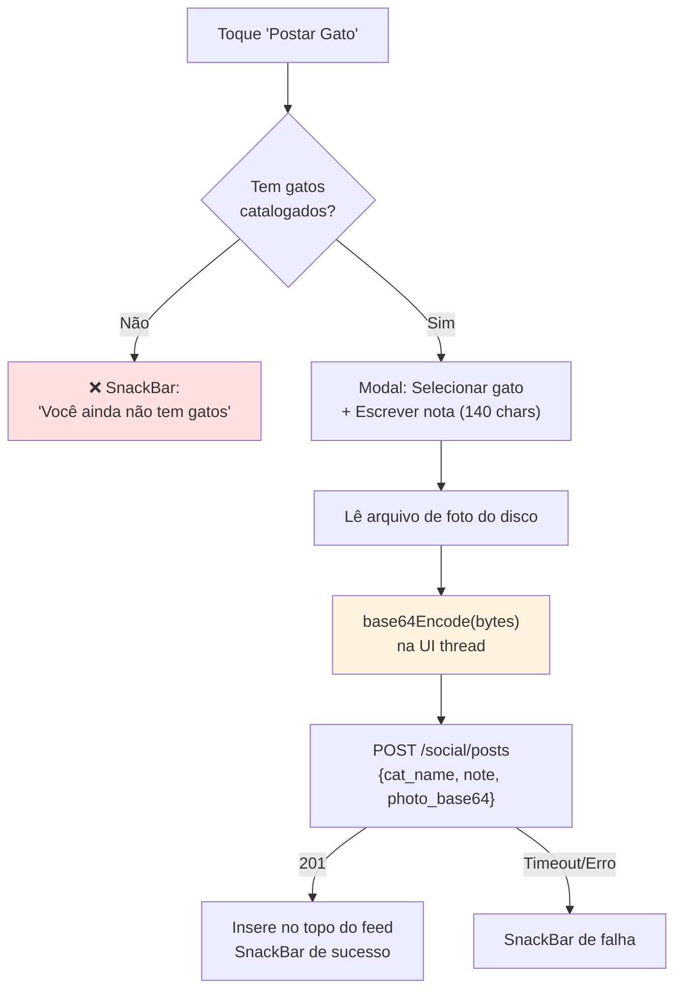
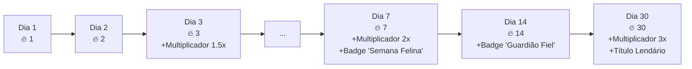
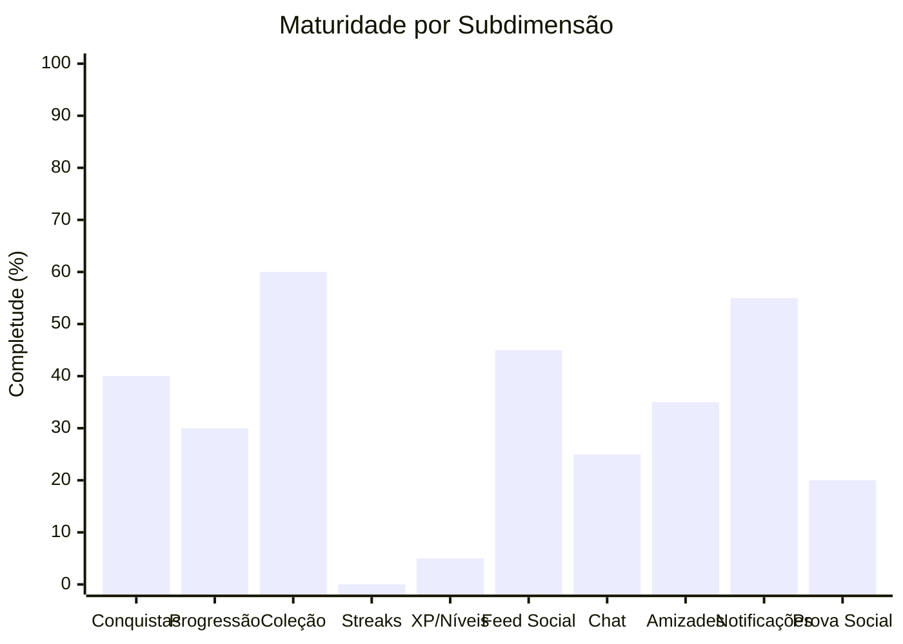

# 🐾 Relatório de Análise Completa — Gatálogo

> **Data:** 15 de Setembro de 2026
> **Escopo:** Análise exaustiva de todas as funcionalidades, fluxos, UX, código e oportunidades de melhoria
> **Arquivos analisados:** 38 arquivos (16 pages, 12 services, 5 models, 2 stores, 4 widgets, config, data, theme)

---

## Sumário Executivo

O Gatálogo é um app tecnicamente sólido na sua arquitetura offline-first e no pipeline de IA (TFLite local + Cloud Vision), mas apresenta **desconexão crítica entre suas funcionalidades sociais e seu objetivo principal** — a localização de gatos perdidos. As funcionalidades sociais estão enterradas na navegação, o chat é superficial demais para ser útil no contexto de resgate, e os mecanismos de engajamento/retenção são insuficientes para criar o hábito diário que alimentaria a base de fotos necessária para o sistema de matching funcionar em escala.

**Resumo dos achados:**
- ✅ **25 pontos fortes** identificados
- ⚠️ **47 problemas de UX e bugs** encontrados
- 🚀 **62 oportunidades** de melhoria e novas funcionalidades
- 🔴 **8 bugs críticos** que afetam a experiência diretamente

---

## 1. Mapa de Funcionalidades Existentes

### 1.1 Autenticação e Sessão
| Funcionalidade | Status | Observação |
|---|---|---|
| Login por e-mail/senha | ✅ Funcional | Senha mínima 12 caracteres |
| Cadastro com verificação OTP | ✅ Funcional | 6 dígitos, cooldown 60s |
| Google Sign-In | ✅ Funcional | Troca de `idToken` via backend |
| Recuperação de senha (2 etapas) | ✅ Funcional | E-mail → código → nova senha |
| Modo offline / explorar sem conta | ✅ Funcional | Acesso limitado |
| Persistência segura de tokens | ✅ Funcional | `FlutterSecureStorage` |
| Refresh automático de JWT | ✅ Funcional | Deduplicação de requisições |
| Apple Sign-In | ❌ Ausente | **Obrigatório pela App Store** |

### 1.2 Captura e Catálogo
| Funcionalidade | Status | Observação |
|---|---|---|
| Captura via câmera | ✅ Funcional | Qualidade 85%, max 1920px |
| Validação local TFLite (preflight) | ✅ Funcional | SSD MobileNet COCO |
| Análise de pelagem por IA na nuvem | ✅ Funcional | Cores, padrão, confiança |
| Persistência offline-first SQLite | ✅ Funcional | 11 migrações de schema |
| Sincronização bidirecional com nuvem | ✅ Funcional | Delta cursor-based |
| Geolocalização de avistamentos | ✅ Funcional | GPS one-shot + geocoding reverso |
| Fotos multi-ângulo (4 poses) | ✅ Funcional | Frente, lados, costas |
| Biblioteca/Catálogo com busca e filtros | ✅ Funcional | Busca por nome/número/local |
| Favoritos | ✅ Funcional | Persistência local em JSON |
| Captura via galeria na tela principal | ❌ Ausente | Botão existe mas não está na UI |

### 1.3 Social e Comunicação
| Funcionalidade | Status | Observação |
|---|---|---|
| Feed de atividades | ✅ Funcional | Posts de gatos + conquistas |
| Sistema de amizades (convites) | ✅ Funcional | Aceitar/rejeitar/remover |
| Chat individual 1x1 | ✅ Funcional | Texto apenas |
| Curtidas em posts | ✅ Funcional | Atualização otimista |
| Comentários em posts | ✅ Funcional | Atualização otimista |
| WebSocket para eventos em tempo real | ✅ Funcional | Reconexão com backoff |
| Push Notifications (FCM) | ✅ Funcional | Background + foreground |
| Envio de fotos no chat | ❌ Ausente | — |
| Status online real | ❌ Ausente | Hardcoded como "online" |
| Tela dedicada de conversas | ❌ Ausente | — |

### 1.4 Gatos Perdidos e Localização
| Funcionalidade | Status | Observação |
|---|---|---|
| Criação de alerta de desaparecimento | ✅ Funcional | Requer pet pré-cadastrado |
| Definição de área e raio de busca | ✅ Funcional | 100m a 50km |
| Matching automático por IA e proximidade | ✅ Funcional | Backend cruza avistamentos |
| Comparação visual lado-a-lado | ✅ Funcional | Zoom fullscreen |
| Confirmação/descarte de pistas | ✅ Funcional | Botões no detalhe da pista |
| Chat com amigo que avistou | ✅ Funcional | Via `ConversationPage` |
| Mapa interativo (flutter_map/OSM) | ✅ Funcional | Markers, clusters |
| Notificação push de pistas | ✅ Funcional | Via FCM |
| Mapa com todas as pistas juntas | ❌ Ausente | Mostra uma por vez |
| Cartaz/panfleto digital para compartilhar | ❌ Ausente | — |

### 1.5 Gamificação e Engajamento
| Funcionalidade | Status | Observação |
|---|---|---|
| Numeração estilo Pokédex (#001) | ✅ Funcional | Sequencial por captura |
| 6 conquistas com 4 níveis de raridade | ✅ Funcional | Com animações de desbloqueio |
| Barra de progresso na Home | ✅ Funcional | Metas por dezenas |
| Compartilhamento de conquistas | ✅ Funcional | No feed social |
| Sistema de XP/Níveis | ❌ Widget existe, sem backend | `GatalogoXPBar` órfão |
| Streaks / ofensivas diárias | ❌ Ausente | — |
| Missões/desafios diários | ❌ Ausente | — |
| Gato do Dia | ❌ Ausente | — |

---

## 2. Bugs Críticos e Problemas Técnicos

> [!CAUTION]
> Estes são problemas que afetam diretamente a funcionalidade ou podem causar crashes.

### 🔴 Bug 1: `LeafDecoration` com caminho de assets quebrado
**Arquivo:** [gatalogo_components.dart](file:///C:/Users/Evelynn_Doescher/Documents/Projetos/flutter/catlogue/lib/widgets/gatalogo_components.dart)
**Problema:** Linha 540 referencia `'assets/images/leaves/Folha_$leafNumber.png'`, mas esse diretório não existe. As folhas estão em `assets/images/Folha_X.png`. O widget renderiza `SizedBox.shrink()` (fallback silencioso) em vez da decoração botânica.

### 🔴 Bug 2: Plataforma hardcoded como `'android'` no registro de push token
**Arquivo:** [social_api_service.dart](file:///C:/Users/Evelynn_Doescher/Documents/Projetos/flutter/catlogue/lib/services/social_api_service.dart)
**Problema:** `'platform': 'android'` está fixo no código. Em iOS, o token APNs é registrado como Android no backend, **quebrando completamente as notificações push no iPhone**.

### 🔴 Bug 3: Mock bypass na desativação de conta
**Arquivo:** [settings_page.dart](file:///C:/Users/Evelynn_Doescher/Documents/Projetos/flutter/catlogue/lib/pages/settings_page.dart)
**Problema:** No bloco `catch` da solicitação de OTP para desativar conta, o erro é engolido e o estado avança como se o código tivesse sido enviado com sucesso. O usuário pode tentar inserir um código que nunca recebeu.

### 🔴 Bug 4: Desativação de conta usa e-mail de "Recuperação de Senha"
**Arquivo:** [settings_page.dart](file:///C:/Users/Evelynn_Doescher/Documents/Projetos/flutter/catlogue/lib/pages/settings_page.dart)
**Problema:** Para enviar o OTP de desativação, o app chama `AuthApiService().requestPasswordReset(email)`. O usuário recebe um e-mail com assunto "Recuperação de Senha" quando está tentando desativar sua conta — confusão total.

### 🔴 Bug 5: Tique duplo de leitura falso no chat
**Arquivo:** [conversation_page.dart](file:///C:/Users/Evelynn_Doescher/Documents/Projetos/flutter/catlogue/lib/pages/conversation_page.dart)
**Problema:** Todas as mensagens enviadas exibem `✓✓` verde fixo, independentemente de terem sido entregues ou lidas. Não há integração real com status de leitura no backend.

### 🔴 Bug 6: Campo "Tipo de pelagem" mostra a cor primária
**Arquivo:** [cat_details_page.dart](file:///C:/Users/Evelynn_Doescher/Documents/Projetos/flutter/catlogue/lib/pages/cat_details_page.dart)
**Problema:** Linha 243 atribui `analysis?.primaryColor` a `hairType`, renderizado como "Tipo de pelagem: Branco" — confunde cor com tipo de pelo.

### 🔴 Bug 7: Notificações de convite de amizade navegam para o feed errado
**Arquivo:** [notifications_page.dart](file:///C:/Users/Evelynn_Doescher/Documents/Projetos/flutter/catlogue/lib/pages/notifications_page.dart)
**Problema:** Notificações de `friend_invite` e `friend_accepted` abrem `SocialPage` (feed de posts) em vez de `FriendsPage` (onde estão os botões de aceitar/rejeitar).

### 🔴 Bug 8: Indicador de estrela de raridade sem diferença visual
**Arquivo:** [gatalogo_gamification.dart](file:///C:/Users/Evelynn_Doescher/Documents/Projetos/flutter/catlogue/lib/widgets/gatalogo_gamification.dart)
**Problema:** Linha 463 usa `LucideIcons.star` tanto para estrelas preenchidas quanto vazias — muda apenas a cor, sem alternar para ícone de estrela contornada.

---

## 3. Problemas de UX e Pontos de Fricção

### 3.1 Navegação e Descobrabilidade

> [!WARNING]
> O social e as conversas estão escondidos, contradizendo o objetivo de incentivar interação.

| # | Problema | Impacto | Local |
|---|---|---|---|
| 1 | **Chat inacessível diretamente** — para conversar, o usuário precisa: Home → Social → pílula "Amigos" → clicar num amigo → POST para criar conversa → chat. São 4-5 cliques. | Altíssimo — abandono do chat | `social_page.dart`, `friends_page.dart` |
| 2 | **Não existe tela de "Conversas Recentes"** — o app não tem inbox de chats. A única forma de ver conversas é pela lista de amigos. | Alto — sem preview de última msg, sem badge de não-lidas | `friends_page.dart` |
| 3 | **Conquistas e amigos escondidos** — só acessíveis pela aba Social (se logado) ou atalhos na Home que competem com 4 botões. | Médio — baixa descobrabilidade | `home_page.dart` |
| 4 | **Bottom navigation sem badges** — não há indicadores visuais de novidades nas abas (mensagens novas, gatos sincronizados). | Médio — perde gatilho de curiosidade | `app.dart` |
| 5 | **Botão "Gatalogar" (câmera) com mesmo peso visual das outras abas** — não há destaque central (estilo FAB) para a ação principal do app. | Médio — a ação core compete visualmente | `app.dart` |

### 3.2 Fluxo de Autenticação

| # | Problema | Impacto | Local |
|---|---|---|---|
| 6 | **OTP sem suporte a colar de clipboard** — cada célula aceita 1 dígito, colar 6 dígitos preenche apenas o primeiro. | Alto — frustração direta | `auth_page.dart` |
| 7 | **Backspace em OTP vazio não volta para a célula anterior** | Médio — quebra de fluxo | `auth_page.dart` |
| 8 | **Sem botão "Voltar" nos modos de verificação** — se o e-mail foi digitado errado, o usuário não consegue corrigir. | Alto — dead-end | `auth_page.dart` |
| 9 | **Sem feedback ao concluir reset de senha** — a tela volta silenciosamente para login. | Médio — insegurança | `auth_page.dart` |
| 10 | **Sem Termos de Serviço / Política de Privacidade no cadastro** | Alto — exigência legal | `auth_page.dart` |
| 11 | **Senha mínima bloqueia login no client-side** — se alguém tem senha < 12 chars pré-existente, não consegue logar. | Alto — bloqueio de acesso | `auth_page.dart` |

### 3.3 Perfil e Configurações

| # | Problema | Impacto | Local |
|---|---|---|---|
| 12 | **Guest user vê "Conta Conectada" com e-mail falso** e checkmark verde ao lado de `explorador@gatalogo.app`. | Médio — informação enganosa | `profile_page.dart` |
| 13 | **Botões de edição de perfil ativos para guest** — tocar neles gera erro de API silencioso. | Médio — frustração | `profile_page.dart` |
| 14 | **Catches silenciosos na carga do perfil** — `catch (_) {}` sem retry ou feedback. | Médio — tela vazia sem explicação | `profile_page.dart` |
| 15 | **Sem pull-to-refresh no perfil** | Baixo | `profile_page.dart` |
| 16 | **Versão do app hardcoded `v1.0.0`** em vez de dinâmica. | Baixo | `settings_page.dart` |
| 17 | **"Desativar Conta com OTP"** — o usuário não sabe o que é OTP. | Médio — jargão técnico | `settings_page.dart` |
| 18 | **Validação de código de desativação aceita 4 dígitos** mas o campo permite 6 e mostra `000000`. | Baixo — inconsistência | `settings_page.dart` |

### 3.4 Captura e Catalogação

| # | Problema | Impacto | Local |
|---|---|---|---|
| 19 | **Sem opção de galeria na tela de captura** — só câmera. Se o gato já foi fotografado antes, precisa tirar de novo. | Alto — barreira de entrada | `capture_page.dart` |
| 20 | **Mensagens de rejeição somem em SnackBar volátil** — o usuário não entende por que a foto foi rejeitada. | Médio — frustração | `capture_page.dart` |
| 21 | **Sem feedback visual da bounding box** — o modelo detecta o gato mas não mostra onde na imagem. | Baixo — oportunidade pedagógica | `capture_page.dart` |
| 22 | **Sem guia de enquadramento (silhueta) na câmera para poses** — a galeria pede "Frente", "Lado esquerdo" etc., mas a câmera abre sem orientação visual. | Médio — fotos ruins | `cat_gallery_page.dart` |
| 23 | **Botão "Compartilhar" é falso** — emite apenas SnackBar estático, sem invocar share nativo. | Alto — promessa quebrada | `cat_details_page.dart` |
| 24 | **Sem "Tentar novamente" quando análise falha** — o método `retryAnalysis` existe no Store, mas nenhuma tela o expõe. | Alto — dead-end para o usuário | `cat_details_page.dart` |
| 25 | **Fotos adicionais mostra "0 fotos" mesmo tendo a foto de cadastro** — conforme relatado em `problemas.md`. | Médio — incoerência | `cat_details_page.dart` |

### 3.5 Social e Chat

| # | Problema | Impacto | Local |
|---|---|---|---|
| 26 | **Botão Compartilhar no feed é mock** — exibe `'Link compartilhado com sucesso.'` sem copiar nada. | Alto — engano | `social_page.dart` |
| 27 | **Fotos em Base64 no JSON do feed** — payload gigantesco, encoding/decoding na UI thread. | Alto — performance e memória | `social_page.dart` |
| 28 | **Sem paginação no feed** — carrega tudo de uma vez. | Alto — ficará lento com o tempo | `social_page.dart` |
| 29 | **Feed não permite postar foto da hora** — obrigatório ter gato pré-catalogado. | Médio — limita conteúdo | `social_page.dart` |
| 30 | **Status online hardcoded como "Amigo no Gatálogo"** com bolinha verde fixa. | Médio — informação falsa | `conversation_page.dart` |
| 31 | **Polling de 30s roda JUNTO com WebSocket** — requisições duplicadas desnecessárias. | Baixo — desperdício de dados | `conversation_page.dart` |
| 32 | **WebSocket recebe msg mas dispara reload completo da lista** em vez de inserir a mensagem pontualmente. | Médio — flash de loading | `conversation_page.dart` |
| 33 | **Convites enviados ficam invisíveis** — sem aba de "Convites Enviados". | Médio — sem feedback | `friends_page.dart` |
| 34 | **Cards de amigos sem preview de última mensagem, data e badge de não-lidas.** | Alto — sem razão para abrir | `friends_page.dart` |
| 35 | **Avatares dos amigos são ícones genéricos** — não carregam a foto real. | Médio — impessoal | `friends_page.dart` |
| 36 | **Adicionar amigo exige username exato** — sem busca, autocomplete ou QR Code. | Alto — barreira social | `friends_page.dart` |

### 3.6 Gatos Perdidos e Mapa

| # | Problema | Impacto | Local |
|---|---|---|---|
| 37 | **Obrigatório cadastrar pet antes de declarar desaparecido** — barreira para situação de urgência. | Alto — atrito em momento crítico | `missing_cats_page.dart` |
| 38 | **Mapa padrão centraliza em Limeira/SP** quando GPS falha. | Médio — confusão geográfica | `location_page.dart` |
| 39 | **Slider de raio impreciso** (100m a 50km em 499 passos) sem campo numérico. | Baixo — ajuste difícil | `location_page.dart` |
| 40 | **Sem busca de endereço por texto** — para achar local distante, precisa arrastar o mapa manualmente. | Alto — inviável para buscas amplas | `location_page.dart` |
| 41 | **Ações de confirmar/descartar pista são irreversíveis** — clique acidental descarta pista sem botão de desfazer. | Médio — perda de informação | `missing_cats_page.dart` |
| 42 | **Geocodificação reversa expõe número residencial** — se o gato foi avistado em casa, o endereço exato é exibido. | Alto — risco de privacidade | `location_service.dart` |

---

## 4. Melhorias para Funcionalidades Existentes

### 4.1 🔐 Autenticação e Sessão

| Melhoria | Prioridade | Justificativa |
|---|---|---|
| **Apple Sign-In** | 🔴 Crítica | Obrigatório pela App Store quando Google Sign-In está presente. Bloqueia publicação no iOS. |
| **Auto-paste de OTP do clipboard** | 🟡 Alta | SMS Retriever API (Android) + auto-fill (iOS) preencheriam os 6 dígitos automaticamente. |
| **Botão "Voltar" nos modos de verificação/reset** | 🟡 Alta | Permite corrigir e-mail digitado errado sem reiniciar o app. |
| **Indicador de força de senha** | 🟢 Média | Checklist visual (maiúscula, número, símbolo, comprimento) reduz rejeições. |
| **Links de Termos de Serviço e Política de Privacidade** | 🔴 Crítica | Exigência legal (LGPD/GDPR). Checkbox de consentimento no cadastro. |
| **Banner de sucesso ao resetar senha** | 🟢 Média | Confirmação visual de que a operação foi concluída. |
| **Evento de sessão expirada** | 🟡 Alta | Notificar o usuário quando o token expira em vez de limpar silenciosamente. |

### 4.2 📸 Captura e Catálogo

| Melhoria | Prioridade | Justificativa |
|---|---|---|
| **Adicionar opção de galeria na CapturePage** | 🔴 Crítica | Remove a barreira de ter que fotografar na hora — o método já existe no código, só falta o botão na UI. |
| **Botão "Tentar novamente" quando análise falha** | 🔴 Crítica | O método `retryAnalysis` já existe no `CatStore`, basta conectar um botão na `CatDetailsPage`. |
| **Implementar compartilhamento real** | 🔴 Crítica | Usar `share_plus` para gerar card visual com foto, nome e stats do gato e compartilhar via OS share sheet. |
| **Corrigir label "Tipo de pelagem"** | 🟢 Média | Separar `primaryColor` de `coatType` no card de análise. |
| **Overlay de silhueta nas poses fotográficas** | 🟡 Alta | Guiar o usuário a encaixar o gato no ângulo correto melhora a qualidade das fotos de reconhecimento. |
| **Filtros avançados na biblioteca** | 🟡 Alta | Filtrar por cor, padrão de pelagem, bairro, status da análise — dados já existem no banco. |
| **Feedback persistente na rejeição de foto** | 🟢 Média | Trocar SnackBar volátil por diálogo modal explicando o motivo e como corrigir. |
| **Exibir bounding box do TFLite na pré-visualização** | 🟢 Média | Mostrar onde o modelo detectou o gato ajuda o usuário a entender o enquadramento. |

### 4.3 💬 Social e Chat

> [!IMPORTANT]
> O chat é a **ponte entre avistamento e resgate**. Um chat limitado a texto puro é insuficiente para coordenar a busca de um gato perdido.

| Melhoria | Prioridade | Justificativa |
|---|---|---|
| **Criar tela dedicada de "Conversas Recentes"** | 🔴 Crítica | Inbox estilo WhatsApp com preview da última msg, timestamp, badge de não-lidas e avatar. Acessível da barra inferior ou como sub-aba do Social. |
| **Envio de fotos no chat** | 🔴 Crítica | Essencial para o contexto de resgate. "Olha, vi um gato parecido aqui!" precisa de foto. |
| **Envio de localização/pin no chat** | 🔴 Crítica | "Ele está aqui!" sem coordenadas é inútil. Botão de pin de GPS no chat. |
| **Compartilhamento de ficha de gato no chat** | 🟡 Alta | Enviar card rico com foto, nome e stats do gato catalogado como mensagem. |
| **Indicador de digitação ("digitando...")** | 🟡 Alta | Via WebSocket, é trivial. Aumenta sensação de presença real. |
| **Status online real e "visto por último"** | 🟡 Alta | Substituir o texto fixo por informação real do backend. |
| **Confirmação de leitura real (✓✓)** | 🟡 Alta | O tique duplo já é renderizado, basta integrá-lo com o backend (marcar mensagens como lidas). |
| **Reações com emoji nas mensagens** | 🟢 Média | Engajamento leve sem necessidade de resposta textual. |
| **Responder/citar mensagem (reply)** | 🟢 Média | Contexto em conversas com múltiplas referências. |
| **Paginação no feed** | 🔴 Crítica | Sem paginação, o feed ficará inutilizável conforme crescer. |
| **Substituir Base64 por URLs de CDN no feed** | 🔴 Crítica | Base64 em JSON causa payloads enormes e encoding/decoding na UI thread. Usar upload multipart + URL pública. |
| **Busca/autocomplete para adicionar amigos** | 🟡 Alta | Digitar username exato é hostil. Busca por nome parcial ou QR Code para adicionar. |
| **Perfil público de outros usuários** | 🟡 Alta | Clicar no avatar de alguém no feed deveria abrir a coleção pública dele. |
| **Convites enviados visíveis** | 🟢 Média | Aba com status dos convites que o usuário enviou (pendente, aceito, recusado). |

### 4.4 🗺️ Gatos Perdidos e Localização

| Melhoria | Prioridade | Justificativa |
|---|---|---|
| **Busca de endereço por texto (geocodificação direta)** | 🔴 Crítica | O usuário precisa encontrar locais digitando o nome, não arrastando o mapa pelo país. |
| **Mapa consolidado de todas as pistas** | 🟡 Alta | Visualizar todos os avistamentos de um alerta simultaneamente em um único mapa com timeline. |
| **Geofencing para alertas de proximidade** | 🟡 Alta | Quando o usuário entrar no raio de busca de um gato perdido, receber notificação proativa. |
| **Fluxo simplificado de alerta de emergência** | 🟡 Alta | Permitir criar alerta com foto rápida sem exigir pet pré-cadastrado completo. |
| **Cartaz/panfleto digital** | 🟡 Alta | Gerar PDF/imagem com foto, nome, contato e QR Code para compartilhar em redes sociais e imprimir. |
| **Campo de microchip, coleira e marcas** | 🟢 Média | Informações que facilitam a identificação presencial do animal. |
| **Avistamento manual** | 🟢 Média | Permitir registrar "vizinho ligou dizendo que viu" sem foto do app. |
| **Fallback de GPS por IP ou cidade do perfil** | 🟢 Média | Substituir Limeira/SP hardcoded por localização aproximada do usuário. |
| **Omitir número residencial na geocodificação** | 🟡 Alta | Exibir apenas rua e bairro, protegendo a privacidade do endereço exato. |

### 4.5 👤 Perfil e Configurações

| Melhoria | Prioridade | Justificativa |
|---|---|---|
| **Separar Perfil de Configurações** | 🟡 Alta | Conforme `problemas.md`: avatar abre overview do perfil, e configurações ficam em tela densa separada. |
| **Troca de senha para usuário logado** | 🟡 Alta | Atualmente só possível via "Esqueci minha senha" estando deslogado. |
| **Troca de e-mail** | 🟢 Média | Migração de conta. |
| **Exportação de dados (LGPD)** | 🟡 Alta | Obrigação legal de data portability. |
| **Links de Suporte/Feedback/Bug Report** | 🟢 Média | Canal de comunicação com os desenvolvedores. |
| **CTA para login quando guest** | 🟡 Alta | No perfil, mostrar prompt claro para criar conta, não campos de edição falhos. |
| **Versão dinâmica via `package_info_plus`** | 🟢 Média | Substituir `v1.0.0` hardcoded. |

---

## 5. Novas Funcionalidades Propostas

### 5.1 🎮 Sistema de Engajamento e Retenção

> [!NOTE]
> O app precisa que os usuários fotografem gatos diariamente para alimentar a base de matching. Sem fotos, o sistema de gatos perdidos não funciona. Cada melhoria de engajamento é, na verdade, uma melhoria direta para a missão social do app.

#### 5.1.1 Streaks / Ofensivas Diárias
- **O que é:** Contador de dias consecutivos em que o usuário registrou pelo menos um avistamento ou interação significativa.
- **Visualização:** Ícone de foguinho na Home com contador de dias, calendário de presença estilo GitHub/Duolingo.
- **Mecânica:** Cada dia com ao menos 1 foto = +1 dia de streak. Perder um dia zera. Possibilidade de "congelar" streak 1x por semana.
- **Impacto:** Cria hábito diário. O Duolingo provou que streaks são o mecanismo de retenção mais poderoso em apps educacionais/gamificados.

#### 5.1.2 Missões Diárias e Semanais
- **O que é:** 3 tarefas rotativas diárias e 1 semanal com recompensas.
- **Exemplos de missões diárias:**
  - "Fotografe um gato de pelagem diferente" → +15 XP
  - "Comente no post de um amigo" → +5 XP
  - "Registre um avistamento com localização" → +10 XP
- **Exemplos de missões semanais:**
  - "Complete o álbum de proteção de 1 pet" → +50 XP
  - "Ajude a encontrar um gato perdido (registre pista)" → +100 XP
- **Impacto:** Direciona o comportamento do usuário para as ações que mais importam para o ecossistema.

#### 5.1.3 Sistema de XP e Níveis
- **O que é:** O widget `GatalogoXPBar` já existe. Falta criar o modelo de dados e integrar.
- **Fontes de XP:**
  - Fotografar gato novo: +20 XP
  - Completar álbum de proteção: +50 XP
  - Registrar avistamento com localização: +15 XP
  - Pista confirmada como match: +100 XP
  - Gato reencontrado por suas fotos: +500 XP
  - Comentar no feed: +3 XP
  - Dia de streak: +5 XP × multiplicador
- **Níveis sugeridos:** Curioso (0) → Explorador (100) → Observador (500) → Guardião (1500) → Protetor (3000) → Lenda Felina (5000).
- **Impacto:** Progressão tangível e visível no perfil. Atribui título ao lado do @username.

#### 5.1.4 "Gato do Dia" / Destaque Rotativo
- **O que é:** A cada dia, destacar na Home um gato diferente da comunidade (com consentimento) ou do próprio catálogo do usuário.
- **Mecânica:** "Gato mais curtido hoje", "Descoberta rara da semana" ou rotação automática do catálogo pessoal.
- **Impacto:** Razão para abrir o app diariamente.

#### 5.1.5 Cards Colecionáveis Visuais
- **O que é:** Transformar cada gato catalogado em um "card colecionável" estilizado com moldura temática baseada na raridade da pelagem, stats visuais (confiança da IA, cores, padrão) e número de série.
- **Impacto:** Dá valor percebido a cada descoberta. Compartilhável em redes sociais.

### 5.2 🌍 Comunidade e Proteção

#### 5.2.1 Mapa Comunitário da Vizinhança
- **O que é:** Mapa público (opt-in) mostrando gatos avistados na região por todos os usuários, com marcadores anônimos.
- **Privacidade:** Coordenadas arredondadas para ±200m. Sem identificação do fotógrafo.
- **Impacto:** Cria senso de comunidade local. "Tem 12 gatos catalogados no meu bairro!"

#### 5.2.2 Notificação Proativa Geolocalizada
- **O que é:** Quando um alerta de gato perdido é criado na sua região, você recebe push: "Um gatinho desapareceu a 800m de você. Fique atento durante seu passeio!"
- **Impacto:** Mobiliza a comunidade sem esforço. Cada usuário se torna um "olheiro" passivo.

#### 5.2.3 Recompensas por Contribuição ao Resgate
- **O que é:** Escalar o sistema de conquistas para quem ajuda:
  - Selo "Anjo Guardião" (1 pista confirmada)
  - Selo "Herói do Bairro" (3 resgates assistidos)
  - Selo "Lenda da Comunidade" (gato efetivamente reencontrado por suas fotos)
- **Impacto:** Incentivo emocional e social poderoso. Visível no perfil público.

#### 5.2.4 "Adotar" um Alerta
- **O que é:** Permitir que amigos "adotem" o alerta de um pet perdido, recebendo as mesmas notificações de pistas e podendo compartilhar o cartaz em suas redes.
- **Impacto:** Multiplica o alcance de cada alerta sem depender apenas do dono.

### 5.3 📱 Qualidade de Vida do App

#### 5.3.1 Dark Mode
- O tema só tem `lightTheme`. Criar `darkTheme` adaptando a paleta terrosa para tons escuros quentes.

#### 5.3.2 Saudação Personalizada
- Substituir "Bem-vindo de volta!" por "Olá, @{username}! 🐾" usando o nome do perfil.

#### 5.3.3 Pull-to-Refresh em Todas as Listas
- Home, Perfil, Feed, Notificações, Pistas — nenhum tem `RefreshIndicator` consistente.

#### 5.3.4 Tratamento Global de Erros
- `main.dart` não captura erros não tratados (`FlutterError.onError`). Adicionar logging e tela de erro amigável.

#### 5.3.5 Cache de Imagens de Rede
- Avatares e fotos do feed usam `Image.network` sem cache. Usar `cached_network_image`.

#### 5.3.6 Badges na Barra de Navegação
- Indicador visual na aba Social quando há mensagens não lidas ou convites pendentes.

#### 5.3.7 Botão Central Destacado para Câmera
- Elevar visualmente o botão "Gatalogar" na barra inferior (estilo FAB) para incentivar a captura.

#### 5.3.8 Notas e Diário do Gato
- Campo para anotações: temperamento, vacinas, chip, coleira, frequência de aparição, local habitual.

#### 5.3.9 Reidentificação Automática
- Ao capturar um gato, comparar com a coleção existente: "Você já viu esse gato em 12/08! Registrar novo avistamento?"

---

## 6. Análise da Arquitetura de Navegação



> [!WARNING]
> **Problema principal:** O Chat (`CH`) e os Amigos (`FR`) estão a 3+ níveis de profundidade na navegação. Para um app com ambição social, conversas deveriam estar a 1 toque de distância. Sugestão: adicionar aba "Conversas" ou sub-tabs dentro do Social.

---

## 7. Análise de Código Órfão e Subutilização

### Widgets criados mas nunca usados em produção:

| Widget | Arquivo | Status |
|---|---|---|
| `GatalogoXPBar` | `gatalogo_gamification.dart` | ❌ Não usado — sem sistema de XP |
| `GatalogoStatCard` | `gatalogo_gamification.dart` | ❌ Não usado — Home e Perfil criaram próprios cards |
| `GatalogoRarityIndicator` | `gatalogo_gamification.dart` | ❌ Não usado em nenhuma tela |
| `LeafDecoration` | `gatalogo_components.dart` | ❌ Quebrado — path de assets errado |
| `GatalogoAvatar` | `gatalogo_components.dart` | ⚠️ Duplica `UserAvatarButton` |

### Métodos implementados mas não expostos na UI:

| Método | Arquivo | Status |
|---|---|---|
| `retryAnalysis(catId)` | `cat_store.dart` | ❌ Pronto, sem botão na UI |
| `_escolherFoto(ImageSource.gallery)` | `capture_page.dart` | ❌ Método existe, sem botão |
| `confirmPasswordReset` | `auth_api_service.dart` | ❌ Redundante, não utilizado |

---

## 8. Matriz de Priorização

### 🔴 Prioridade Crítica (Bloqueadores / Lançamento)
1. Apple Sign-In (obrigatório para App Store)
2. Fix plataforma hardcoded `'android'` no push token
3. Links de Termos de Serviço e Política de Privacidade
4. Fix endpoint de OTP na desativação de conta
5. Fix mock bypass na desativação
6. Botão de galeria na tela de captura
7. Paginação no feed social
8. Substituir Base64 por URLs de CDN no feed
9. Tela de conversas recentes (inbox de chat)
10. Busca de endereço por texto no mapa

### 🟡 Prioridade Alta (Engajamento e Retenção)
11. Envio de fotos e localização no chat
12. Botão "Tentar novamente" na análise falha
13. Compartilhamento real (share_plus)
14. Sistema de streaks diários
15. Missões diárias/semanais
16. Sistema de XP e níveis
17. Geofencing para alertas de proximidade
18. Cartaz digital de gato perdido
19. Badges na barra de navegação inferior
20. Busca/autocomplete para adicionar amigos
21. Separar Perfil de Configurações
22. Auto-paste de OTP
23. Confirmação de leitura real no chat
24. Indicador de digitação
25. Exportação de dados (LGPD)

### 🟢 Prioridade Média (Polimento e Qualidade de Vida)
26. Dark Mode
27. "Gato do Dia" na Home
28. Saudação personalizada com nome
29. Pull-to-refresh em todas as telas
30. Cards colecionáveis visuais
31. Mapa comunitário da vizinhança
32. Filtros avançados na biblioteca
33. Overlay de silhueta nas poses
34. Notas e diário do gato
35. Reidentificação automática
36. Reações e replies no chat
37. Perfil público de outros usuários
38. Cache de imagens de rede
39. Tratamento global de erros
40. Versão dinâmica

---

## 9. Resumo Visual



| Área | Nota | Veredicto |
|---|---|---|
| **Autenticação** | 7.2/10 | Funcional, falta Apple Sign-In e polimentos legais |
| **Catálogo e IA** | 7.8/10 | Sólido tecnicamente, falta expor retry e galeria |
| **Social/Feed** | 4.5/10 | Existe mas é raso — sem paginação, com Base64, mock de share |
| **Chat** | 3.0/10 | Apenas texto. Para resgate de gatos, é insuficiente |
| **Gatos Perdidos** | 6.5/10 | Pipeline funcional, falta geofencing e ferramentas de mobilização |
| **Gamificação** | 3.5/10 | 6 conquistas básicas. Sem XP, streaks, missões ou recompensas |
| **UX Geral** | 5.5/10 | Bonito mas com dead-ends, mocks e navegação confusa |

---

## 10. Conclusão e Visão Estratégica

O Gatálogo tem uma **fundação técnica impressionante** (offline-first, TFLite, sincronização bidirecional, WebSocket) e uma **identidade visual encantadora**, mas está operando como um álbum de fotos bonito com funcionalidades sociais superficiais.

Para cumprir sua missão de **localizar gatos perdidos**, o app precisa resolver um dilema de rede: **sem usuários fotografando gatos diariamente, não há base de dados para o matching funcionar**. A solução passa por:

1. **Tornar o ato de fotografar irresistível** — streaks, XP, missões diárias, cards colecionáveis.
2. **Tornar o social acessível e útil** — chat com fotos/localização, inbox de conversas, perfis públicos.
3. **Tornar a participação no resgate recompensadora** — selos especiais, notificações geolocalizadas, cartaz digital.
4. **Eliminar os dead-ends** — botão de retry, galeria na captura, share real, busca de endereço.

> [!TIP]
> O ciclo virtuoso do Gatálogo deveria ser: **Fotografar gatos → Ganhar XP e streak → Compartilhar no feed → Atrair amigos → Mais fotos na base → Melhor matching de gatos perdidos → Resgates bem-sucedidos → Reconhecimento social → Mais motivação para fotografar**. Cada funcionalidade proposta neste relatório alimenta alguma parte desse ciclo.

---
---

# 🎮 PARTE II — Análise Profunda: Gamificação, Engajamento e Social

> **Escopo:** Complemento ao relatório principal com foco exclusivo e detalhado nos sistemas de gamificação, loops de engajamento, mecânicas de coleção, grafo social, criação de conteúdo, comunicação em tempo real e barreiras ao engajamento.

---

## 11. Sistema de Conquistas — Radiografia Completa

### 11.1 Catálogo de Todas as Conquistas

O app possui **6 conquistas** definidas localmente em [`journey_page.dart`](file:///C:/Users/Evelynn_Doescher/Documents/Projetos/flutter/catlogue/lib/pages/journey_page.dart) (linhas 12–79) com 4 níveis de raridade:

| # | ID | Título | Descrição | Ícone | Meta | Raridade | Cor |
|---|---|---|---|---|---|---|---|
| 1 | `'first'` | Primeira Descoberta | Fotografe e catalogue seu primeiro gato em um passeio ao ar livre. | `Icons.pets` | 1 | 🟢 Comum | `#7E9B70` |
| 2 | `'collector_5'` | Olhar Curioso | Aviste e catalogue 5 gatos diferentes pelo seu bairro. | `LucideIcons.search` | 5 | 🟢 Comum | `#7E9B70` |
| 3 | `'angles'` | Fotógrafo Felino | Adicione ângulos e fotos complementares ao perfil de um gato. | `LucideIcons.camera` | 2 | 🔵 Incomum | `#5BA3C4` |
| 4 | `'days'` | Guardião dos Dias | Registre avistamentos em 3 dias de calendário distintos. | `LucideIcons.calendar` | 3 | 🩷 Raro | `#DC8BA1` |
| 5 | `'helper'` | Rede de Cuidado | Contribua com uma pista para reencontrar um gato desaparecido. | `LucideIcons.heartHandshake` | 1 | 🩷 Raro | `#DC8BA1` |
| 6 | `'master_collector'` | Mestre do Gatálogo | Reúna 20 gatos catalogados na sua coleção botânica. | `LucideIcons.crown` | 20 | 🏆 Lendário | `#F5C853` |

### 11.2 Fórmulas Exatas de Cálculo de Progresso

```dart
// Dias distintos com registro
final days = store.discoveries
    .map((cat) => displayDate(cat.capturedAt))
    .toSet()
    .length;

// Maior quantidade de fotos de referência em um único gato
final angles = store.cats.fold<int>(
  0,
  (best, cat) => store.referencePhotosFor(cat.id).length > best
      ? store.referencePhotosFor(cat.id).length : best,
);
```

| Conquista | Fórmula de Progresso | Observação |
|---|---|---|
| `'first'` | `discoveries.isEmpty ? 0 : 1` | Binário: tem ou não tem |
| `'collector_5'` | `discoveries.length.clamp(0, 5)` | Contagem de gatos de rua |
| `'angles'` | `angles.clamp(0, 2)` | Fotos de referência do gato com mais poses |
| `'days'` | `days.clamp(0, 3)` | Dias únicos no Set de datas |
| `'helper'` | **`0` (HARDCODED)** | ⚠️ Nunca progride offline |
| `'master_collector'` | `discoveries.length.clamp(0, 20)` | Mesma fonte que `collector_5`, meta maior |

> [!WARNING]
> **Problema crítico:** A conquista `'helper'` (Rede de Cuidado) tem progresso fixado em `0` no cálculo local. O `CatStore` não armazena o histórico de pistas enviadas para gatos perdidos, então o progresso só existe no backend — mas se o backend estiver offline, o usuário sempre vê `0/1` mesmo que já tenha contribuído. Isso desmotiva diretamente a participação no resgate, que é a **missão central do app**.

### 11.3 Animações de Desbloqueio

Quando uma conquista muda para `AchievementState.completed`:

| Elemento | Animação | Duração | Curva |
|---|---|---|---|
| Card inteiro | `ScaleTransition` via `TweenSequence`: 1.0 → 1.03 → 1.0 (pulso elástico) | **600ms** (`AppDurations.celebration`) | `Curves.elasticOut` |
| Container | `AnimatedContainer`: borda expande de 1px para **2px** na cor da raridade, fundo ganha tint 10% | **400ms** (`AppDurations.slow`) | `Curves.easeInOut` |
| Troféu | `RotationTransition` ("respiração"): -7.2° a +7.2° em loop contínuo | **4 segundos** por ciclo | `Curves.easeInOutSine` |
| Shimmer (Lendário) | `ShaderMask` com gradiente diagonal branco `alpha 0→0.4→0` | Constante | Linear |
| Cards bloqueados | Opacidade cai para **50%**, ícone vira `LucideIcons.lock` | — | — |

### 11.4 Problemas Estruturais do Sistema de Conquistas

| # | Problema | Impacto |
|---|---|---|
| 1 | **Sem níveis/tiers nas conquistas** — cada conquista é um marco único (0 ou 1). Não existe Bronze/Prata/Ouro. | Após completar os 6 marcos, não há mais progresso. O sistema "morre" cedo. |
| 2 | **Sem celebração instantânea** — desbloquear um marco ao fotografar NÃO dispara confetti/toast/modal. O usuário só descobre ao abrir `JourneyPage`. | Perde o momento de dopamina imediata. |
| 3 | **Sem timestamp visível** — `unlocked_at` existe na API mas a UI nunca exibe "Desbloqueado em 12/09/2026". | Sem memória emocional do momento. |
| 4 | **Conquistas de resgate inacessíveis offline** — `'helper'` sempre mostra 0/1 sem backend. | Desmotiva a missão social central. |
| 5 | **Apenas 6 conquistas** — para um jogo de coleção, é um número muito baixo. Apps similares têm 30-50+. | Usuários completam tudo em dias. |
| 6 | **Conquistas no feed não recebem curtidas/comentários** — cards dourados no feed não têm botões de interação. | A celebração social fica sem resposta, quebrando o loop de recompensa variável. |
| 7 | **Compartilhar conquista só gera SnackBar** — sem visual de card compartilhado ou preview. | Feedback genérico, sem satisfação. |

---

## 12. Sistema de Progressão — Estado Atual

### 12.1 Barra de Metas na Home

A Home possui uma barra de progresso cujo alvo se move dinamicamente:

```dart
final nextMilestone = catCount < 10
    ? 10
    : ((catCount ~/ 10) + 1) * 10;
final progress = (catCount / nextMilestone).clamp(0.0, 1.0);
```

**Comportamento Psicológico Inteligente:**
- Com 10 gatos, a meta pula para 20, mas o progresso exibe **50%** (10/20), não 0%.
- Isso aplica o **Efeito de Progresso Endowed** (Endowed Progress Effect) — o usuário sente que já está no meio do caminho, não começando do zero.
- Rótulo: `'Próxima conquista: $nextMilestone gatos.'`

**Problema:** A meta é sempre um múltiplo de 10, sem variação. Após 50-100 gatos, avançar de 100 para 110 não gera emoção. Falta escalamento de recompensas.

### 12.2 Sistema de XP/Níveis — Widget Órfão

> [!CAUTION]
> O widget `GatalogoXPBar` existe em [`gatalogo_gamification.dart`](file:///C:/Users/Evelynn_Doescher/Documents/Projetos/flutter/catlogue/lib/widgets/gatalogo_gamification.dart) (linhas 474–558) com implementação completa e visual bonito (barra dourada com ícone de brilho ✨), mas:
> - **Não é instanciado em NENHUMA tela do app**
> - **Não existe modelo de dados de XP** no `Cat`, `SessionStore`, `CatStore` ou banco SQLite
> - **Não existe endpoint de API** para XP ou níveis
> - O título `'Explorador Felino'` na JourneyPage é **texto estático hardcoded**, não um nível calculado
>
> Todo o sistema de XP/Níveis é scaffolding visual sem lógica de negócio.

### 12.3 Numeração Pokédex

Cada gato recebe `capture_number` via `SELECT COALESCE(MAX(capture_number), 0) + 1 FROM cats`.
- Display: `'Gato #001'`, `'Gato #002'` (3 dígitos, zero-padded)
- Buscável na biblioteca por número (`#001`, `1`)
- Efeito psicológico: cria senso de **preenchimento de álbum** — números faltantes geram "gaps" que o colecionador quer preencher

**Problema:** Não há visualização de "Pokédex grid" mostrando slots preenchidos vs vazios. A numeração existe mas não é explorada visualmente como um álbum.

---

## 13. Mecânicas de Coleção — Análise de Satisfação

### 13.1 Duas Trilhas de Coleção

```dart
List<Cat> get discoveries => cats.where((cat) => !cat.isOwned).toList();  // Gatos de rua
List<Cat> get pets => cats.where((cat) => cat.isOwned).toList();           // Meus gatos
```

| Trilha | Gameplay | Tela | Alimenta Conquistas? |
|---|---|---|---|
| **Descobertas** (`discoveries`) | Pokémon: sair, explorar, fotografar, colecionar | `LibraryPage` | ✅ Sim — `first`, `collector_5`, `days`, `master_collector` |
| **Meus Gatos** (`pets`) | Tamagotchi: cadastrar, proteger, álbum multi-ângulo | `MyCatsPage` | ❌ Não alimentam contagem de descobertas |

**Problema:** Os "Meus Gatos" não possuem **nenhuma conquista dedicada**. Cadastrar 3 pets, completar todos os álbuns de proteção, declarar desaparecido e reencontrar — nada disso é gamificado. Uma trilha inteira de gameplay não gera recompensas.

### 13.2 O Que Torna Cada Gato "Único"

| Diferenciador | Como funciona | Satisfação |
|---|---|---|
| Número sequencial (#001) | Auto-incremento no SQLite | 🟢 Cria senso de raridade temporal |
| Nome personalizável | Modal de renomear | 🟢 Vínculo emocional |
| Análise de IA (pelagem, cores, confiança) | Cloud Vision API | 🟢 Cada gato tem "stats" únicos |
| Localização geográfica | GPS + geocoding reverso | 🟢 Memória do lugar |
| Álbum multi-ângulo (4 poses) | Fotos de referência | 🟡 Satisfação de completude |
| Data/hora de captura | Timestamp UTC | 🟢 Memória temporal |

**O que falta para maximizar unicidade:**
- Avatar 3D gerado (modelo `CatAvatar` existe no código mas não é renderizado)
- Card colecionável visual com moldura, stats e raridade
- "Personalidade" ou tags (brincalhão, tímido, carinhoso)
- Histórico de re-avistamentos do mesmo gato
- Comparação de raridade da pelagem com o catálogo global

### 13.3 Sistema de Favoritos

| Aspecto | Status |
|---|---|
| Persistência | Arquivo JSON local (`favorites_cats.json`) |
| Sincronização nuvem | ❌ **Zero** — troca de dispositivo perde tudo |
| Animação de curtir | ✅ Pulso com bounce: escala 1.0→1.35→1.0 em 300ms (`Curves.easeOutBack`) |
| Filtro na biblioteca | ✅ Chip "Favoritos" filtra em tempo real |
| Visível na Home | ❌ Não — cards recentes não mostram coração |
| Conquista por favoritar | ❌ Nenhuma |
| Limite de favoritos | Sem limite |

---

## 14. Grafo Social — Anatomia Completa

### 14.1 Modelo de Relacionamento



**Características:**
- **100% simétrico** — não há seguidores/seguidos
- **Sem conta pública** — sem perfil visitável por estranhos
- **Sem grafo de segundo grau** — não há "amigos em comum" ou "sugestões"

### 14.2 Mecanismos de Descoberta de Amigos

| Mecanismo | Status |
|---|---|
| Busca por username exato | ✅ Único método existente |
| Busca por nome parcial / autocomplete | ❌ Ausente |
| Sincronização de contatos do telefone | ❌ Ausente |
| Sugestões "Pessoas que você talvez conheça" | ❌ Ausente |
| QR Code de perfil | ❌ Ausente |
| Link de convite compartilhável (`gatalogo.app/add/@user`) | ❌ Ausente |
| Diretório de exploradores locais / da cidade | ❌ Ausente |
| Botão "Adicionar" no perfil do feed ao ver post de alguém | ❌ Ausente (perfis nem existem) |

> [!WARNING]
> **Este é o gargalo número 1 do crescimento social.** O app exige que o usuário conheça a grafia exata do `@username` de alguém que já usa o app. Em um app novo com poucos usuários, isso cria um **ciclo morto**: sem amigos → sem feed → sem razão para voltar → sem crescimento.

### 14.3 Onde a Contagem de Amigos Aparece

| Local | Formato | Ação ao tocar |
|---|---|---|
| `FriendsPage` cabeçalho | `'Amigos & Conversas (N)'` | — |
| `FriendsPage` convites | `'Convites Recebidos (N)'` | — |
| `ProfilePage` card roxo | `'N Amigos ➔'` | Abre `FriendsPage` |
| `HomePage` | ❌ **Não aparece** | — |
| `SocialPage` | ❌ **Não aparece** | — |
| Barra inferior | ❌ **Sem badge** | — |

---

## 15. Criação de Conteúdo e Compartilhamento

### 15.1 Fluxo de Publicação no Feed



### 15.2 Problema de Performance do Base64

| Etapa | Problema | Impacto |
|---|---|---|
| Upload | Foto bruta sem compressão (~3-8 MB) → Base64 (+33%) = **4-11 MB de JSON** | Timeout frequente em 3G/4G |
| Download no feed | `base64Decode()` na UI thread dentro do `itemBuilder` do `SliverList` | **Jank visual** ao rolar o feed |
| Memória | Cada foto em Base64 fica na RAM como string + bytes decodificados | Risco de OOM em feeds longos |
| Comparação | Avatar em `ProfilePage` usa upload multipart com `maxWidth: 600` — mas posts de gatos **não comprimem** | Inconsistência de abordagem |

### 15.3 Mapa Completo de Botões de Compartilhar (Real vs Mock)

| Localização | Texto/Ícone | Funciona? | O que faz de verdade |
|---|---|---|---|
| Feed → Post de gato | `LucideIcons.share2` | ❌ **MOCK** | `showMessage('Link compartilhado com sucesso.')` |
| Feed → "Postar Gato" | Botão publicar | ✅ Real | `POST /social/posts` |
| Conquista → "Compartilhar com amigos" | `LucideIcons.share2` | ✅ Real | `POST /app/journey/{id}/share` → aparece no feed |
| Detalhes do gato → "Compartilhar" | `LucideIcons.share2` | ❌ **MOCK** | `showMessage('Compartilhando descoberta de ...')` |
| Perfil do pet → álbum de proteção | — | ❌ Não existe | — |

> **3 de 5 ações de compartilhar são falsas.** Isso quebra a confiança do usuário e impede o crescimento orgânico via redes externas (WhatsApp, Instagram).

---

## 16. Chat — Comparativo Detalhado com WhatsApp

### 16.1 Funcionalidades Presentes vs Ausentes

| Funcionalidade | WhatsApp | Gatálogo | Status |
|---|---|---|---|
| Balões de mensagem com cores diferenciadas | ✅ | ✅ Verde claro (enviadas) / branco (recebidas) | ✅ Implementado |
| Separadores de data (Hoje, Ontem, data) | ✅ | ✅ Lógica idêntica | ✅ Implementado |
| Horário no canto do balão | ✅ | ✅ `HH:mm` | ✅ Implementado |
| Tique duplo de entrega/leitura | ✅ Real | ⚠️ **Falso** — sempre verde | 🔴 Cosmético |
| Status online / "visto por último" | ✅ Real | ⚠️ **Fixo** — "Amigo no Gatálogo" | 🔴 Hardcoded |
| Indicador de digitação | ✅ | ❌ | ❌ Ausente |
| Envio de fotos | ✅ | ❌ | ❌ Ausente |
| Envio de áudio/voz | ✅ | ❌ | ❌ Ausente |
| Envio de localização/pin | ✅ | ❌ | ❌ Ausente |
| Envio de documentos/arquivos | ✅ | ❌ | ❌ Ausente |
| Reações com emoji | ✅ | ❌ | ❌ Ausente |
| Responder/citar mensagem | ✅ | ❌ | ❌ Ausente |
| Copiar texto da mensagem | ✅ | ❌ | ❌ Ausente |
| Apagar mensagem (para mim/todos) | ✅ | ❌ | ❌ Ausente |
| Editar mensagem enviada | ✅ | ❌ | ❌ Ausente |
| Bloquear/denunciar contato | ✅ | ❌ | ❌ Ausente |
| Silenciar conversa | ✅ | ❌ | ❌ Ausente |
| Buscar mensagens | ✅ | ❌ | ❌ Ausente |
| Figurinhas/stickers | ✅ | ❌ | ❌ Ausente |
| Lista de conversas recentes | ✅ | ❌ | ❌ Ausente |

> **Resultado: 3 implementadas / 2 falsas / 16 ausentes.** O chat atual é funcional para texto básico, mas radicalmente insuficiente para coordenar o resgate de um gato perdido, que requer compartilhar fotos e localização.

### 16.2 O Banner de Contexto de Avistamento

Quando uma conversa é aberta a partir de uma pista de gato perdido, o backend retorna `sighting_context: true`. A UI exibe:

- Banner verde fixo no topo do chat
- Ícone: `Icons.pets` (patinha verde)
- Título: **"Pista de avistamento"**
- Subtítulo: *"Compartilhem detalhes para ajudar a reencontrar o gato desaparecido."*

**Problema:** O banner diz "compartilhem detalhes", mas o chat **só permite texto**. O usuário não pode enviar a foto do gato avistado nem o pin de GPS de onde ele está — justamente as informações mais críticas para o resgate.

---

## 17. Loops de Engajamento — Mapeamento Completo

### 17.1 Loops Existentes (Trigger → Ação → Recompensa → Investimento)

```mermaid
flowchart TD
    subgraph Loop1["🎯 Loop 1: O Colecionador"]
        T1["Ver gato na rua\nou meta na Home"] --> A1["Fotografar na CapturePage"]
        A1 --> R1["IA analisa e revela pelagem\n+ Número Pokédex atribuído"]
        R1 --> I1["Gato salvo no catálogo\n+ Progresso de conquista"]
    end

    subgraph Loop2["💬 Loop 2: O Comunicador"]
        T2["Badge no sino\nou push notification"] --> A2["Abrir notificação\n→ Entrar no chat"]
        A2 --> R2["Resposta do amigo\nValidação social"]
        R2 --> I2["Histórico de conversa\nVínculo fortalecido"]
    end

    subgraph Loop3["🏆 Loop 3: O Conquistador"]
        T3["Barra de progresso na Home\n'Faltam X gatos'"] --> A3["Sair para explorar\nem dias diferentes"]
        A3 --> R3["Conquista desbloqueada!\nTroféu com animação"]
        R3 --> I3["Compartilhar no feed\nReconhecimento dos amigos"]
    end

    subgraph Loop4["🐾 Loop 4: O Resgatador"]
        T4["Push: 'Possível match\ncom gato perdido'"] --> A4["Abrir pista\nComparar fotos"]
        A4 --> R4["Confirmar: 'É meu gato!'\nou chat com avistador"]
        R4 --> I4["Gato reencontrado\nConquista 'Rede de Cuidado'"]
    end

    style Loop1 fill:#F1F5ED
    style Loop2 fill:#E8F4FD
    style Loop3 fill:#FEF9E7
    style Loop4 fill:#FCEBE8
```



### 17.2 Onde os Loops Estão Quebrados

| Loop | Ponto de Quebra | Consequência |
|---|---|---|
| **Colecionador** | Sem opção de galeria na captura | Usuário que já fotografou antes pelo app nativo não consegue catalogar |
| **Colecionador** | Sem celebração instantânea de conquista | O "aha moment" de desbloqueio é perdido — usuário descobre dias depois |
| **Comunicador** | Chat sem fotos/localização | Impossível compartilhar o que mais importa: "olha o gato!" e "ele está aqui!" |
| **Comunicador** | Sem inbox de conversas | Usuário não sabe se tem mensagens novas sem navegar 3 telas |
| **Conquistador** | Conquistas no feed sem interação | Amigos veem o card dourado mas não podem curtir nem comentar — zero feedback social |
| **Conquistador** | Apenas 6 conquistas, sem tiers | Sistema se esgota em 1-2 semanas de uso ativo |
| **Resgatador** | `'helper'` hardcoded em 0 offline | Progresso invisível desmotiva a participação |
| **Resgatador** | Compartilhar externamente é mock | Não pode gerar cartaz ou enviar para WhatsApp |
| **TODOS** | Sem streaks | Nenhum incentivo para abrir o app AMANHÃ |

### 17.3 O Problema do "Cold Start" Social

Quando um novo usuário se cadastra e abre a aba Social:

1. **Feed totalmente vazio** — nenhum conteúdo do mundo, apenas gatinho dormindo
2. Botão "Postar Gato" → **bloqueado** (ainda não tem gato catalogado)
3. Botão "Convidar Amigos" → abre campo de username → **sem sugestão de quem convidar**
4. **Resultado:** O usuário vê uma cidade fantasma e nunca mais volta à aba Social

**Soluções necessárias:**
- Feed global/público com conteúdo de toda a comunidade (opt-in)
- Bot de boas-vindas ou "Gatálogo Oficial" com dicas e posts iniciais
- Sugestões de usuários ativos na mesma cidade/região
- Primeiro gato catalogado automaticamente sugerido para postar

---

## 18. Prova Social e Visibilidade

### 18.1 Elementos de Prova Social Existentes

| Elemento | Onde aparece | Impacto |
|---|---|---|
| Contador de curtidas (patinha + número) | Posts no feed | 🟢 Validação quantitativa |
| Contador de comentários (balão + número) | Posts no feed | 🟢 Sinal de engajamento |
| Card dourado de conquista no feed | Feed dos amigos | 🟡 Estímulo mas sem interação |
| Badge "Explorador" com total de gatos no perfil | `ProfilePage` | 🟡 Visível só para si mesmo |
| Bolinha verde "Amigo no Gatálogo" | Chat | 🔴 Falsa — sempre exibe online |

### 18.2 O Muro de Invisibilidade de Perfis

| Ação | Resultado |
|---|---|
| Tocar no avatar de alguém no feed | **Nada acontece** — sem `onTap` |
| Tocar no `@username` de alguém no feed | **Nada acontece** |
| Tocar no amigo na lista de amigos | Abre **chat**, não perfil |
| Ver a coleção de gatos de um amigo | **Impossível** |
| Ver os troféus de um amigo | **Impossível** |
| Ver a bio de um amigo | **Impossível** |

> **Consequência:** Sem perfis visitáveis, não há aspiração social. O usuário não sabe quantos gatos seu amigo tem, quais conquistas desbloqueou, nem como é a coleção dele. Sem comparação, não há competição saudável nem inspiração.

### 18.3 Elementos Competitivos

| Tipo | Status | Detalhes |
|---|---|---|
| Leaderboard / ranking semanal | ❌ Ausente | — |
| Comparativo entre amigos ("Fulano tem 15, você tem 8") | ❌ Ausente | — |
| Ranking por bairro ou cidade | ❌ Ausente | — |
| Badges de raridade no perfil público | ❌ Ausente | Badges existem nos widgets mas não são mostradas em perfis |
| Sequência de dias (streak) visível no perfil | ❌ Ausente | — |
| "Collector Score" ou pontuação geral | ❌ Ausente | — |

---

## 19. Barreiras ao Engajamento Social

### 19.1 Contagem de Toques para Cada Ação Social (a partir da Home)

| Ação | Caminho | Toques |
|---|---|---|
| Ver feed social | Aba "Social" na barra inferior | **1** |
| Curtir um post | Aba Social → toque na patinha | **2** |
| Comentar em um post | Aba Social → ícone comentários → digitar → enviar | **4** |
| Postar um gato | Aba Social → "Postar Gato" → selecionar → escrever → publicar | **5** |
| Ver lista de amigos | Atalho "Amigos" na Home | **1** |
| Abrir um chat | Atalho "Amigos" → tocar no amigo | **2** |
| Enviar mensagem | Amigos → amigo → digitar → enviar | **4** |
| Aceitar convite | Amigos → scroll até convites → aceitar | **2-3** |
| Adicionar amigo | Amigos → digitar @username exato → enviar | **3** |
| Ver perfil de outro usuário | **❌ IMPOSSÍVEL** | ∞ |
| Compartilhar externamente | **❌ MOCK** | — |

### 19.2 Barreira de Autenticação

| Feature | Guest pode acessar? |
|---|---|
| Feed social | ❌ Tela de bloqueio total |
| Chat | ❌ Requer Bearer token |
| Postar | ❌ Requer Bearer token |
| Curtir/comentar | ❌ Requer Bearer token |
| Enviar convite | ❌ Requer Bearer token |
| Ver notificações | ❌ Requer Bearer token |
| **Catalogar gatos** | ✅ Funciona offline |
| **Navegar biblioteca** | ✅ Funciona offline |
| **Ver conquistas locais** | ✅ Funciona offline |

> O modo guest permite a experiência individual completa, mas toda a dimensão social é inacessível. Não há nem um "preview" do que o usuário ganharia ao criar conta.

---

## 20. Widgets de Gamificação Órfãos e Subutilizados

### 20.1 Inventário Completo

| Widget | Arquivo | Usado? | Onde deveria estar |
|---|---|---|---|
| `GatalogoXPBar` | `gatalogo_gamification.dart` | ❌ **Nunca usado** | Home (abaixo do card de coleção) e Perfil |
| `GatalogoStatCard` | `gatalogo_gamification.dart` | ❌ **Nunca usado** | Home (substituindo cards manuais) e Perfil |
| `GatalogoRarityIndicator` | `gatalogo_gamification.dart` | ❌ **Nunca usado** | Cards de gato na biblioteca e detalhes |
| `GatalogoAchievementCard` | `gatalogo_gamification.dart` | ✅ Usado em `JourneyPage` | OK |
| `GatalogoTrophyIcon` | `gatalogo_gamification.dart` | ✅ Usado em `JourneyPage` | OK |
| `GatalogoProgressBar` | `gatalogo_components.dart` | ✅ Usado em `JourneyPage` | Home usa implementação manual em vez deste |
| `GatalogoBadge` | `gatalogo_components.dart` | ⚠️ Inconsistência | Labels em inglês (`'Common'`) vs português no `gatalogo_gamification.dart` (`'Comum'`) |
| `GatalogoCard` | `gatalogo_components.dart` | ✅ Usado em `MyCatsPage` | Home recriou cards do zero em vez de usar |
| `LeafDecoration` | `gatalogo_components.dart` | 🔴 **Quebrado** | Path `assets/images/leaves/` não existe |
| `GatalogoAvatar` | `gatalogo_components.dart` | ⚠️ Duplica | Duplica `UserAvatarButton` de `app_widgets.dart` |

### 20.2 Fragmentação da Home

A `HomePage` recria widgets que já existem na biblioteca de componentes:

| O que a Home cria | Widget equivalente existente | Por que é problema |
|---|---|---|
| `_RecentCatCard` (inline) | `GatalogoCard` | Duplicação de código, estilos divergem |
| `_ShortcutCard` (inline) | `GatalogoStatCard` | Duplicação de código |
| `LinearProgressIndicator` manual | `GatalogoProgressBar` | Perde animação e estilo padronizado |

---

## 21. Propostas Detalhadas de Gamificação e Engajamento

### 21.1 Sistema de Streaks (Ofensivas Diárias)



**Mecânicas recomendadas:**
- **Ação de qualificação diária:** Fotografar 1 gato OU registrar 1 avistamento OU interagir no feed (curtir/comentar/postar)
- **Multiplicador de XP:** 1x (dias 1-2), 1.5x (dias 3-6), 2x (dias 7-13), 3x (dias 14+)
- **Escudo de proteção:** 1 congelamento gratuito por semana (não quebra o streak se perder 1 dia)
- **Visibilidade:** Ícone de foguinha na Home, no perfil e compartilhável no feed
- **Perda:** Animação triste do mascote ao quebrar o streak (empatia, não punição)

### 21.2 Sistema de XP e Níveis (Ativar o Widget Órfão)

**Fontes de XP propostas:**

| Ação | XP Base | Com Multiplicador de Streak |
|---|---|---|
| Fotografar gato novo (descoberta) | +20 XP | +30-60 XP |
| Adicionar foto de referência (ângulo) | +10 XP | +15-30 XP |
| Completar álbum de 4 ângulos | +50 XP (bônus) | +75-150 XP |
| Registrar avistamento com localização | +15 XP | +22-45 XP |
| Postar no feed | +5 XP | +7-15 XP |
| Receber curtida em post | +2 XP | — |
| Comentar em post de amigo | +3 XP | +4-9 XP |
| Pista de resgate enviada | +25 XP | +37-75 XP |
| Pista confirmada como match | +100 XP | +150-300 XP |
| Gato efetivamente reencontrado | +500 XP | — |
| Dia de streak mantido | +5 XP × dia | Acumulativo |
| Convidar amigo aceito | +30 XP | — |

**Níveis propostos:**

| Nível | Título | XP Necessário | Desbloqueio |
|---|---|---|---|
| 1 | Curioso | 0 | — |
| 2 | Explorador | 100 | Moldura de perfil verde |
| 3 | Observador | 300 | Moldura azul + filtro de pelagem na biblioteca |
| 4 | Catalogador | 700 | Moldura roxa + card colecionável básico |
| 5 | Guardião | 1.500 | Moldura dourada + título no perfil |
| 6 | Protetor | 3.000 | Moldura animada + badge "Protetor" |
| 7 | Lenda Felina | 6.000 | Efeito shimmer no perfil + título lendário |

### 21.3 Expansão de Conquistas (de 6 para 25+)

**Novas conquistas propostas por categoria:**

#### 🐱 Coleção
| Conquista | Meta | Raridade |
|---|---|---|
| Explorador do Bairro | 10 gatos em bairros diferentes | Incomum |
| Colecionador de Cores | Ter gatos de 5 cores distintas | Incomum |
| Fotógrafo Dedicado | Completar 3 álbuns de proteção | Raro |
| Enciclopédia Viva | 50 gatos no catálogo | Lendário |

#### 📅 Consistência
| Conquista | Meta | Raridade |
|---|---|---|
| Semana Felina | 7 dias seguidos de streak | Comum |
| Mês do Gato | 30 dias seguidos de streak | Raro |
| Madrugador Felino | Registrar avistamento antes das 7h | Incomum |
| Observador Noturno | Registrar avistamento após as 20h | Incomum |

#### 🤝 Social
| Conquista | Meta | Raridade |
|---|---|---|
| Primeiro Amigo | Adicionar 1 amigo | Comum |
| Rede Social | 10 amigos conectados | Incomum |
| Influenciador Felino | Receber 50 curtidas totais | Raro |
| Animador | Comentar em 20 posts de amigos | Incomum |

#### 🐾 Resgate
| Conquista | Meta | Raridade |
|---|---|---|
| Anjo Guardião | 3 pistas confirmadas | Raro |
| Herói do Bairro | 5 resgates assistidos | Lendário |
| Reencontro Feliz | 1 gato efetivamente reencontrado | Lendário |

#### 🗺️ Exploração
| Conquista | Meta | Raridade |
|---|---|---|
| Turista Felino | Avistamentos em 3 cidades diferentes | Raro |
| Mapeador | 20 avistamentos com localização | Incomum |

### 21.4 Missões Diárias e Semanais

**Estrutura proposta:**

| Tipo | Quantidade | Renovação | Recompensa |
|---|---|---|---|
| Missão diária | 3 ativas | 00:00 local | 10-25 XP cada |
| Missão semanal | 1 ativa | Segunda-feira | 50-100 XP |
| Missão bônus (rara) | 1 eventual | Aleatória, 20% chance/dia | 50 XP + badge temporário |

**Exemplos de missões diárias:**
- 📸 "Fotografe um gato que você nunca viu antes" → +20 XP
- 💬 "Envie uma mensagem para um amigo" → +10 XP
- 🐾 "Registre um avistamento com localização" → +15 XP
- ❤️ "Curta 3 posts no feed" → +10 XP
- 📝 "Comente em um post de amigo" → +10 XP
- 🗺️ "Registre um avistamento em um novo bairro" → +25 XP

**Exemplos de missões semanais:**
- 🏆 "Complete todas as missões diárias por 5 dias esta semana" → +100 XP
- 📸 "Adicione 2 ângulos ao álbum de proteção de um pet" → +50 XP
- 🤝 "Convide um novo amigo para o Gatálogo" → +75 XP

### 21.5 Celebração Instantânea de Conquistas

**Proposta de Overlay Comemorativo:**

Quando o usuário completa uma conquista em qualquer tela (ao fotografar, ao postar, ao ajudar):

1. **Overlay modal semitransparente** escurece a tela
2. **Troféu animado** com a cor da raridade surge do centro com scale 0→1 + bounce
3. **Confetti** de patinhas e estrelas caindo por 2 segundos
4. **Título:** "🎉 Conquista Desbloqueada!"
5. **Nome e descrição** da conquista com badge de raridade
6. **Botões:** "Compartilhar com amigos" (real, no feed) e "Continuar"
7. **Som:** feedback háptico (`HapticFeedback.mediumImpact`)

### 21.6 "Gato do Dia" na Home

**Mecânica proposta:**
- Seção entre o card de coleção e as descobertas recentes
- Rotação diária do catálogo pessoal com card visual destacado
- "Gato da Comunidade" (mais curtido do dia, se houver feed público)
- Toque abre detalhes e incentiva adicionar fotos/ângulos
- Gera razão para abrir o app mesmo sem sair de casa

---

## 22. Propostas de Melhoria Social

### 22.1 Inbox de Conversas (Tela Dedicada)

**Proposta de layout:**

| Elemento | Descrição |
|---|---|
| Avatar do amigo | Foto real (não ícone genérico) |
| Nome/username | `@fulano` |
| Preview da última mensagem | Truncada em 1 linha |
| Timestamp | "Agora", "14:30", "Ontem", "12/09" |
| Badge de não-lidas | Contador circular rosa |
| Banner de contexto | Tag "🐾 Pista de avistamento" se `sighting_context` |
| Ordenação | Mais recente primeiro |

**Acessibilidade:** Acessível a 1 toque da barra inferior (sub-tab do Social ou nova aba).

### 22.2 Perfil Público de Outros Usuários

**Campos visíveis ao visitar o perfil de um amigo:**
- Avatar, nome, bio, nível/XP
- Contagem de gatos catalogados
- Conquistas desbloqueadas (badges visuais)
- Streak atual
- Galeria pública de gatos (com consentimento)
- Botão "Enviar mensagem"

### 22.3 Mecanismos de Descoberta Social

| Mecanismo | Prioridade | Impacto Esperado |
|---|---|---|
| **QR Code do perfil** — escanear com a câmera do app para adicionar | 🔴 Crítica | Conversão presencial alta |
| **Link de convite** — `gatalogo.app/add/@user` para compartilhar no WhatsApp | 🔴 Crítica | Crescimento viral |
| **Busca por nome parcial** — digitar "Mar" e ver "Maria", "Marcos", "Marta" | 🟡 Alta | Reduz atrito de digitação |
| **"Exploradores perto de você"** — lista anônima de usuários ativos na mesma cidade | 🟢 Média | Descoberta passiva |
| **"Amigos em comum"** — "Você e @fulano têm 3 amigos em comum" | 🟢 Média | Confiança social |

---

## 23. Matriz de Priorização — Gamificação, Engajamento e Social

### 🔴 Impacto Imediato (Resolver em 1-2 sprints)

| # | Item | Tipo | Justificativa |
|---|---|---|---|
| 1 | Celebração instantânea de conquista (overlay) | Gamificação | Sem o "momento de dopamina", conquistas são invisíveis |
| 2 | Inbox de conversas recentes | Social | Sem inbox, o chat é inacessível |
| 3 | Envio de fotos no chat | Social | Impossível coordenar resgate sem foto |
| 4 | Envio de localização no chat | Social | Impossível dizer "ele está AQUI" |
| 5 | QR Code e link de convite para amigos | Social | Gargalo #1 do crescimento |
| 6 | Fix: conquistas no feed precisam de curtidas/comentários | Social | Loop de feedback social quebrado |
| 7 | Fix: `'helper'` com progresso local real | Gamificação | Missão central do app invisível |
| 8 | Fix: compartilhamento real (3 botões mock) | Engagement | Crescimento orgânico bloqueado |
| 9 | Paginação no feed social | Técnico | Feed vai travar com crescimento |
| 10 | Substituir Base64 por CDN/multipart no feed | Técnico | Performance e estabilidade |

### 🟡 Engajamento de Médio Prazo (3-5 sprints)

| # | Item | Tipo | Justificativa |
|---|---|---|---|
| 11 | Sistema de Streaks diários | Gamificação | Principal mecanismo de hábito |
| 12 | Sistema de XP e Níveis (ativar widget órfão) | Gamificação | Progressão tangível e visível |
| 13 | Missões diárias e semanais | Gamificação | Direciona comportamento desejado |
| 14 | Expansão de conquistas (6 → 25+) | Gamificação | Sistema atual se esgota em dias |
| 15 | Perfil público de outros usuários | Social | Aspiração e comparação social |
| 16 | Confirmação de leitura real no chat | Social | Tique duplo falso é enganoso |
| 17 | Indicador de digitação | Social | Presença real em tempo real |
| 18 | Status online real | Social | Substituir texto hardcoded |
| 19 | Badges na barra de navegação inferior | UX | Gatilho visual de curiosidade |
| 20 | Feed global/público (opt-in) | Social | Resolve cold start para novos usuários |

### 🟢 Polimento e Diferenciação (6+ sprints)

| # | Item | Tipo | Justificativa |
|---|---|---|---|
| 21 | "Gato do Dia" na Home | Engagement | Razão diária para abrir o app |
| 22 | Cards colecionáveis visuais com moldura de raridade | Gamificação | Valor percebido de cada descoberta |
| 23 | Leaderboard semanal entre amigos | Competição | Competição saudável |
| 24 | Conquistas de resgate escalonadas | Gamificação | Incentiva missão social |
| 25 | Reações emoji em mensagens | Social | Engajamento leve |
| 26 | Responder/citar mensagem (reply) | Social | Contexto em conversas |
| 27 | Visualização de Pokédex grid (slots preenchidos vs vazios) | Gamificação | Explorar FOMO de coleção |
| 28 | Favoritos sincronizados na nuvem | Técnico | Persistência entre dispositivos |
| 29 | Notificação "Explorador perto de você" | Social | Descoberta passiva |
| 30 | Avatar 3D gerado (ativar modelo `CatAvatar`) | Diferenciação | Feature única no mercado |

---

## 24. Conclusão da Análise de Gamificação, Engajamento e Social



O Gatálogo possui **fundação sólida** em três áreas — a mecânica de coleção offline-first, o pipeline de IA para análise de pelagem, e os widgets de gamificação (que são visualmente bonitos). Porém, o sistema de engajamento está operando com **fração da capacidade projetada**:

- **3 widgets de gamificação nunca foram ativados** (XPBar, StatCard, RarityIndicator)
- **6 conquistas é um número insuficiente** — apps de coleção bem-sucedidos têm 30-50+
- **Zero mecanismos de hábito diário** — sem streaks, sem missões, sem "gato do dia"
- **O social é um "walled garden" inacessível** — sem perfis, sem discovery, sem inbox
- **3 de 5 botões de compartilhar são falsos** — bloqueia crescimento orgânico
- **O chat não suporta o caso de uso principal** — resgate de gatos precisa de fotos e GPS

> [!IMPORTANT]
> **A prioridade absoluta é ativar o ciclo social e de engajamento.** O app já sabe *catalogar* gatos com excelência técnica. O que falta é criar *razões para catalogar mais*, *razões para voltar amanhã* e *razões para trazer amigos*. Sem isso, a base de fotos permanece pequena e o sistema de matching de gatos perdidos — a razão de existir do app — nunca atinge massa crítica.

---

## 25. Design de Jogo: Mapeamento Avançado de Assets 3D Locais

Foi identificada a presença da pasta `assets/3d_assets/` no projeto, contendo centenas de modelos no formato GLB (`.glb`). Ignorando temporariamente a possibilidade de mapas 3D urbanos, esse acervo (Nature Kit, Food Kit, Cube Pets e Mini Dungeon) permite **transformar o Gatálogo de um simples catálogo em um jogo completo de gerenciamento e coleção (estilo Neko Atsume + Pokémon GO)**, fechando as lacunas de engajamento diário e retenção identificadas no relatório.

Abaixo, propomos um sistema de jogo profundo utilizando a variedade completa dos modelos disponíveis:

### 25.1 O Sistema de "Habitat Personalizável" (MyCatsPage 2.0)
**Kits utilizados:** `kenney_nature-kit` (329 modelos) e `kenney_cube-pets_1.0`

No modelo atual, a `MyCatsPage` é estática. Com o 3D, cada gato resgatado ou catalogado ganha seu próprio "Habitat" 3D interativo (Diorama), que o usuário pode decorar.
- **O Mascote Principal:** O modelo **`animal-cat.glb`** substitui a `CatAvatar` órfã. Variações de cor e textura (material overrides no Flutter) podem ser aplicadas dinamicamente com base na pelagem detectada pela IA (ex: frajola, siamês, escaminha).
- **A Base do Bioma (Chão):** Dependendo de onde o usuário fotografou o gato (geolocalização), a base do diorama muda usando **`platform_grass.glb`** (parques), **`platform_stone.glb`** (ruas/asfalto) ou **`platform_beach.glb`** (areia).
- **Customização do Habitat (Sistema de Decoração):** O usuário pode gastar XP/Moedas para mobiliar o espaço do gato com as centenas de modelos do Nature Kit.
  - *Móveis Felinos:* **`stump_old.glb`** (para o gato sentar), **`tent_detailedOpen.glb`** (gatos amam caixas/tendas), **`log_stack.glb`**.
  - *Botânica (Herbário):* **`tree_oak.glb`**, **`tree_pineSmallA.glb`**, **`plant_bushDetailed.glb`**, **`hanging_moss.glb`**.
  - *Flores de Raridade:* O usuário pode plantar **`flower_redA.glb`**, **`flower_purpleA.glb`**, ou **`lily_large.glb`** no habitat, que crescem (mudam de scale 0 para 1) conforme o usuário completa o "álbum de ângulos" daquele gato.

### 25.2 Economia, Lojinha e "Neko Atsume" Mechanics
**Kits utilizados:** `kenney_food-kit` (200 modelos) e `kenney_mini-dungeon`

Para fazer os usuários voltarem todos os dias (retenção), introduzimos a mecânica de "Alimentar" e um sistema de loja usando a infinidade de comidas disponíveis no Food Kit.
- **A Moeda do Jogo (CatCoins):** Representada pelo modelo **`coin.glb`** girando na tela. Ganhos ao catalogar, cumprir streaks ou ajudar em resgates.
- **Loja de Comidinhas (Food Kit):**
  - *Comida Básica (Grátis Diário):* **`bowl.glb`** (Pote vazio que enche), **`carton-small.glb`** (Caixinha de leite).
  - *Comida Premium (Custa Moedas):* O usuário pode comprar **`fish.glb`**, **`sushi-salmon.glb`**, **`meat-sausage.glb`** ou **`can-open.glb`** (Lata de atum).
  - *Mecânica de Isca (Neko Atsume):* O usuário coloca um prato Premium (ex: **`bowl-soup.glb`** ou **`steak.glb`**) no seu terreno virtual na Home para "atrair" virtualmente gatos de raridade Lendária ou para ganhar XP em dobro (usando a `GatalogoXPBar`) nas próximas 24 horas.
- **Easter Eggs Alimentares:** Se o usuário der **`watermelon.glb`** (melancia) ou **`pizza.glb`**, o modelo do gato reage com uma animação de susto ou alegria (referência a vídeos de internet).

### 25.3 Lootboxes e Gamificação de Alto Nível
**Kits utilizados:** `kenney_mini-dungeon`

A atual tela `JourneyPage` tem 6 conquistas planas em SVG. Isso pode virar uma sala de troféus 3D.
- **Unboxing de Conquistas:** Ao bater uma meta (ex: 5 descobertas), em vez de apenas um SnackBar, um **`chest.glb`** cai na tela. O usuário precisa tocar nele, o baú abre, e de dentro sai o troféu da conquista com partículas.
- **Troféus de Raridade:** As conquistas passam a ter níveis físicos:
  - *Comum:* **`wood-support.glb`** ou **`barrel.glb`** com o ícone flutuando.
  - *Raro:* **`potion.glb`** (poção brilhante).
  - *Lendário:* **`column.glb`** de pedra com o item em cima e shader dourado.
- **Recompensas de Resgate Real:** Se o usuário ajudar a encontrar um gato perdido na vida real (o principal objetivo do app), ele recebe a **`key.glb`** (A Chave da Cidade) dourada e imponente na sua estante 3D, a maior prova de status social no perfil público.

**Conclusão da Arquitetura 3D:**
Com esses +550 modelos já locais, você não precisa de 10 assets, mas sim criar um **metajogo de customização**. O loop perfeito se torna: *Sair para a rua → Fotografar gatos reais → Ganhar Moedas (`coin.glb`) → Ir na Loja Virtual → Comprar Comidas (`fish.glb`) e Plantas (`tree_oak.glb`) → Decorar o habitat 3D do seu Gato Favorito (`animal-cat.glb`) → Compartilhar o print do diorama renderizado no Feed Social para os amigos curtirem.* Isso gera retenção infinita, status e prova social.
